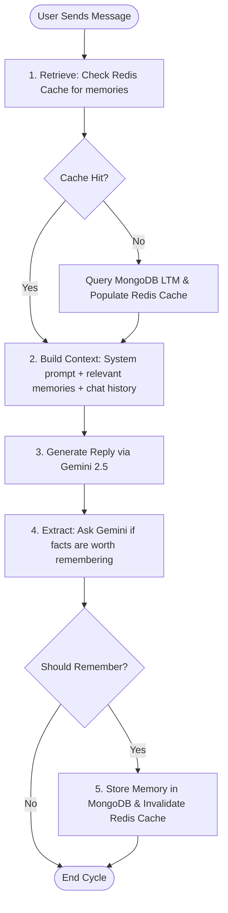

# Memora AI — Your Context-Aware Thinking Partner

Memora AI is a context-aware chatbot designed for deep work. Unlike typical chatbot platforms that treat each new session as a blank slate, Memora actively parses your messages, extracts key preferences or background facts, stores them in a MongoDB database, and dynamically builds them back into context queries. 

---

## Architectural Overview

Memora AI separates **chat history** from **long-term memory stores**. Memory isn't bound to individual chat threads; it is stored as discrete preference snippets linked to the user's account and retrieved contextually across any chat session.



---

## Key Features

*  **Persistent Long-Term Memory**: Automatically tracks preferences, software stacks, goals, and facts across different chat sessions.
*  **Relevance Scoring Pipeline**: Evaluates memories for relevance on every prompt using keyword matching based on:
  * **Similarity** (60% weight) - Keyword overlaps.
  * **Importance** (25% weight) - Assigned by Gemini (1–10 scale) during extraction.
  * **Recency** (10% weight) - Decay over 30 days.
  * **Access Count** (5% weight) - Bumped each time a memory is retrieved.
* **Comprehensive Privacy Policy**: Access policies detailing how database vectors, local credentials, and Google Gemini API requests are secured.
*  **Mobile-First Layout**: Fully responsive navbar, sidebars, and input overlays tested for small touchscreens.

---

##  Project Structure

* [backend/](file:///C:/Users/Asus/xCODE/memora-ai/backend) — Express server handling authentication, conversation logging, preference parsing, and Gemini API calls.
* [frontend/](file:///C:/Users/Asus/xCODE/memora-ai/frontend) — Vite React client styled with high-performance vanilla CSS variables.
* [docs/](file:///C:/Users/Asus/xCODE/memora-ai/docs) — Deep architectural files:
  * [memory-pipeline.md](file:///C:/Users/Asus/xCODE/memora-ai/docs/memory-pipeline.md): Detailed explanation of the 5-step retrieval cycle.

---

## Configuration & Environment

To run the project, you need to populate `.env` files for both frontend and backend.

### Backend Configurations
Create a [backend/.env](file:///C:/Users/Asus/xCODE/memora-ai/backend/.env) file:
```env
PORT=port_number
MONGODB_URI=your_db_uri
JWT_SECRET=your_jwt_secret_key_here
GEMINI_API_KEY=your_gemini_api_key_here
```

### Frontend Configurations
Create a [frontend/.env](file:///C:/Users/Asus/xCODE/memora-ai/frontend/.env) or rely on Vite's default dev environment:
```env
VITE_API_URL=http://localhost:5173
```

---

##  Getting Started

### Prerequisites
* Node.js (v18+)
* MongoDB running locally or a MongoDB Atlas URI
* Docker for local Redis Setup `docker run -d --name my-redis -p 6379:6379 redis:latest`

### Installation & Run

1. **Clone & Setup Backend**:
   ```bash
   cd backend
   npm install
   npm run dev
   ```
   *The server runs on [http://localhost:3000](http://localhost:5000)*

2. **Setup Frontend**:
   ```bash
   cd ../frontend
   npm install
   npm run dev
   ```
   *The app compiles and hosts locally on [http://localhost:5173](http://localhost:5173)*

---

##  Deployment

### 1. Backend (Render)
When deploying the Express backend to [Render](https://render.com):
* **Build Command**: `npm install`
* **Start Command**: `npm start`
* **Environment Variables**:
  * `NODE_ENV`: `production`
  * `MONGODB_URI`: Your MongoDB Atlas connection string
  * `DB_NAME`: `db`
  * `CORS_ORIGIN`: `https://memora-ai-pi.vercel.app` (or a comma-separated list like `https://memora-ai-pi.vercel.app,http://localhost:5173` to allow both production and local development)
  * `JWT_SECRET_KEY`: A secure random string for JWT signatures
  * `GEMINI_API_KEY`: Your Gemini API developer key
  * `REDIS_URL`: Your production Redis server URL (e.g., from Upstash or Redis Labs)

### 2. Frontend (Vercel)
When deploying the Vite + React frontend to [Vercel](https://vercel.com):
* **Root Directory**: `frontend`
* **Build Command**: `npm run build`
* **Output Directory**: `dist`
* **Environment Variables**:
  * `VITE_API_URL`: `https://memora-ai-9i3n.onrender.com/api/v1`

---

##  Privacy & Compliance

Memora AI incorporates user privacy indicators:
* **Account-Bound Isolation**: Memories are query-scoped to individual users.
* **Agreement Consent**: Users must review and accept the [Privacy Policy Page](file:///C:/Users/Asus/xCODE/memora-ai/frontend/src/pages/PrivacyPolicy.jsx) before submitting signup credentials.
* **Strict API Pipelines**: Transmissions to Gemini contain only current prompt context and relevant context-matched metadata (no raw passwords or session tables).
